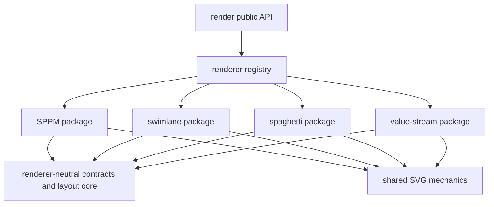

# Renderer Architecture Boundaries

Status: accepted

## Purpose

Keep SPPM, swimlane, spaghetti, and value stream as four independent
renderers while allowing them to consume a small renderer-neutral platform.

## Package map

Each diagram owns an explicit package and artifact entrypoint:

- `src/flo/render/sppm/`
- `src/flo/render/swimlane/`
- `src/flo/render/spaghetti/`
- `src/flo/render/value_stream/`

SPPM and swimlane also own their ELK request builders in `layout.py`. Shared
ELK code accepts measured node sizes and edge decorations through callbacks;
it does not import a renderer package. Spaghetti and value stream own their
direct spatial projection and SVG emission end to end.

Renderer-neutral infrastructure consists of:

- artifact and diagnostic contracts
- resolved render options and themes
- `src/flo/render/shared/` for truly shared SVG mechanics
- `src/flo/render/layout_core/` for layout contracts, execution,
  normalization, placement, routing, and geometry
- `src/flo/render/registry.py` for executable registration and dispatch

`src/flo/render/capability_matrix.py` is a compatibility view generated from
the executable registry; it is not a second registration table.

## Dependency direction

The arrows do not run back from shared code to renderer packages, and renderer
packages do not import one another. Swimlane therefore owns its shapes and
edges rather than inheriting SPPM presentation behavior.

## Ownership rules

1. Put behavior in a renderer package when its semantics or visual convention
   belongs to one diagram family.
2. Put code in `shared/` only when it is renderer-neutral and already useful
   across diagram families.
3. Keep layout contracts and execution in `layout_core/`; inject
   renderer-owned measurement and decoration policy through narrow callbacks.
4. Register each supported diagram/backend pair once in `registry.py`.
5. Do not preprocess canonical IR globally for renderer convenience. A
   renderer-specific projection belongs inside that renderer.
6. Do not restore flat `_svg_*`, `_sppm_*`, backend-selector, Graphviz, or DOT
   renderer modules.

## Final geometry and orchestration

The [layout finalization ADR](../adr/render_layout_finalization.md) clarifies
ownership for release acceptance. Diagram-owned policy finalizes geometry before
SVG emission; neutral engine adapters do not define SPPM rules. CLI, Python,
golden, and diagnostic consumers use one production orchestration path, with
stage observation where needed. Existing implementation violations remain open
in the [validation report](../architecture_validation.md).

## Enforcement

- Import Linter's eleven contracts enforce package direction, independent renderers,
  and sibling cycles. The neutral infrastructure contract covers all of
  `layout_core/` and `shared/`, plus neutral root modules, and forbids direct or
  indirect dependencies on diagram implementations or registry/dispatch views.
  There are no migration import exemptions.
- Policy tests require every new root render module or package to be classified
  as neutral, diagram-owned, or dispatch. Neutral modules are also checked
  recursively for imports back through the public render facade. Adding a file
  cannot silently escape the old hand-picked module list.
- `uv run lint-imports` and `uv run python scripts/architecture_boundaries.py`
  run as unfiltered pre-commit hooks and in CI's all-files hook run. The latter
  needs neither Node nor a rendering engine and now passes after R3b.
  Its SPPM-policy scan covers all neutral layout Python modules, and its call
  detectors recognize imported aliases. These are specific responsibility
  probes, not proof that arbitrarily renamed or hidden policy is neutral.
- `tests/policy/test_renderer_architecture_boundaries.py` requires all four
  package entrypoints, rejects legacy flat modules, and rejects global render
  preprocessing.
- Focused artifact and layout tests prove SPPM and swimlane retain independent
  behavior across the shared ELK seam.
- Installed-wheel architecture checks remain required on both platforms and
  before package publication. The fast source gate supplements them. R1–R3
  must add call-through and geometry-consumer contract tests alongside the new
  execution and finalized-geometry interfaces; those interfaces are still pending.

## References

- `docs/design/renderers/sppm.md`
- `docs/design/renderers/swimlane.md`
- `docs/design/renderers/spaghetti.md`
- `docs/design/renderers/value_stream.md`
- `docs/design/adr/render_stack_elk_svg_typst.md`
- `docs/design/adr/simplified_package_architecture.md`

## Shared execution contract (R1)

Complete artifact consumers use `flo.render.render_execution`; existing public
artifact APIs delegate to it and keep their return types. Optional
`capture_layout=True` returns detached engine-stage snapshots alongside the
resolved artifact and prepared options. Golden tooling consumes this result and
may not import request builders, engine normalization, emission, or viewport
implementation helpers. Tests instrument the common entrypoint and constrain
the golden tool's imports. Capture does not supply finalized geometry: R3 remains
responsible for that contract.

Layout-only diagnostic helpers and precomputed-layout SVG emission explicitly
name their intermediate stage. Page-local publication figures use the diagram
entrypoint with planner-owned figure options rather than duplicate the engine
sequence or apply standalone viewport policy.

## Diagram policy input contract (R2)

The core serializes explicit `ElkSerialization` data supplied by request builders
and runs an optional `ElkLayoutRequest.result_transform` on normalized coordinates.
It does not branch on diagram tags, read diagram strategy variables, choose
correction placement, or infer diagram-specific reserved/helper IDs. SPPM owns
those choices and resolves them before supplying the request. Swimlane supplies
its own settings. Shared coordinate and intersection mechanisms remain neutral.

Tests exercise neutral requests under different diagram tags/environment values,
explicit transformation execution, payload isolation, and independent swimlane
configuration. The fast source gate scans all neutral modules for diagram-tag
dispatch and SPPM symbols/literals, complementing full-tree import contracts. The
AF-001 was subsequently closed by R3b; R4 records candidate acceptance.

## Routed geometry consumption contract (R3a)

SPPM orchestration finalizes nodes, routes, visible lanes, content canvas bounds,
and correction membership into `RoutedGeometry` before invoking `sppm.svg`.
`RenderExecution.geometry_stages` exposes this stage when capture is requested.
The value uses detached read-only geometry mappings and frozen coordinate values;
emission cannot change node/route placement through it. Import Linter forbids
SVG emission from depending on the node/route layout policy or ELK execution,
including indirect paths. Tests parse SVG emitted from deliberately changed
supplied geometry and retain independent final-SVG checks.

R3a is a partial geometry contract: edge shape attachment, annotation placement,
occupied bounds, and remaining viewport/band decisions await R3b. The emitter
still performs those operations, so AF-001 remains a release blocker.

## Final scene contract (R3b)

`FinalScene` supplies attached connectors, annotation boxes and text baselines,
occupied annotation bounds, publication bands, content origin/natural dimensions,
and diagnostics. `sppm.svg` and `sppm.edge_svg` only serialize supplied geometry
and apply paint/typography. Their transitive import contract excludes finalizers,
attachment and annotation policy, avoidance, and graph layout. Node primitives
format glyphs and card internals inside supplied node bounds; they do not move
process nodes, route edges, or run inter-element collision policy.

One production execution prepares registered diagram-owned options, executes
layout, finalizes the scene, emits SVG, and resolves generic artifact viewport/fit.
The final numeric viewport is explicit in the artifact metadata. Optional captures
expose engine, routed, and final-scene stages without changing the public artifact
return contract. Layout/route-only helpers and private compatibility test adapters
remain explicitly intermediate consumers, never complete production alternatives.
